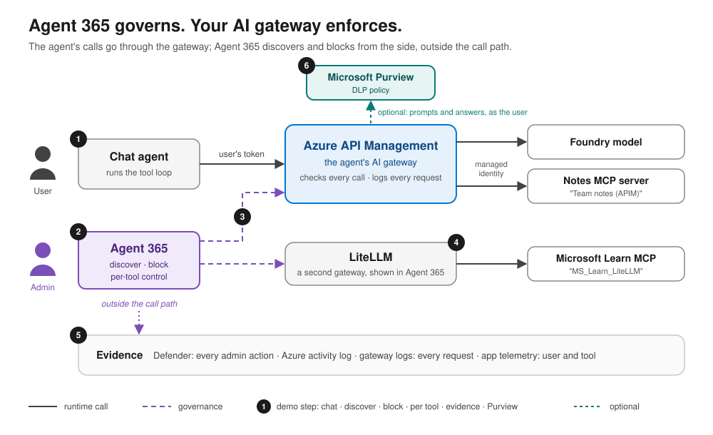
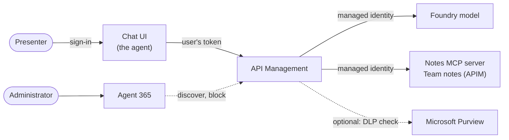
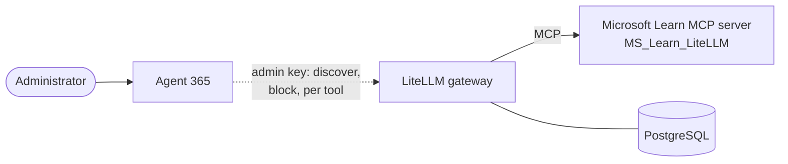

<div align="center">

# AI agent governance with Agent 365 and AI gateways

**Your AI gateway runs the traffic. Agent 365 governs it.**

[](LICENSE)
[](infra)
[](azure.yaml)
[](services/notes-mcp)

[**Quick start**](#quick-start) · [**What the demo shows**](#what-the-demo-shows) · [**Architecture**](#architecture) · [**Evidence**](#evidence-behind-this-demo) · [**Cost**](#cost)

</div>

A chat agent reaches its model and its MCP tools only through **Azure API Management**, with the user's own token.
From the Microsoft 365 admin center, **Agent 365** discovers those tools and blocks them within seconds, without sitting
in the call path, on API Management and on a second gateway, **LiteLLM**. Optionally, **Microsoft Purview** checks what
goes to the model and what comes back.

<p align="center">
  
</p>

## Why this demo

Organisations already put an AI gateway in front of their models and tools, to authenticate callers, log every request
and control costs. As agents start calling tools on their own, administrators also need to see which tools exist, stop
one quickly, and show afterwards who did what. This demo shows how Agent 365 adds that governance to the gateways you
run, API Management and LiteLLM, from the Microsoft 365 admin center, without changing the agent's call path.

## What the demo shows

| # | Step | What the audience sees |
|---|---|---|
| 1 | Chat through API Management | The presenter adds and lists notes in the chat; each MCP tool call is shown. The model and the notes MCP server are reached only through API Management, which checks the user's token. |
| 2 | Discovery | Microsoft 365 admin center, Agents > Tools: "Team notes (APIM)" (per server, no tools listed) next to "MS_Learn_LiteLLM" (with its tools); Agents > Settings > Gateways: the two connections. |
| 3 | Block | Blocking "Team notes (APIM)": a timer shows the next MCP request refused within seconds (`AccessBlockedByGateway`); unblocking restores it. |
| 4 | Per tool | Disabling one tool of "MS_Learn_LiteLLM": a probe shows that tool refused within seconds while the others still work. |
| 5 | Evidence | Records from a run the day before: the administrator's actions on both gateways in Microsoft Defender, API Management's gateway logs, Azure's activity log, the app's telemetry. |
| 6 | Optional: Purview at the gateway | API Management checks what goes to the model and what comes back with Microsoft Purview, as the user: a credit card number is refused in a prompt and in an answer ([PURVIEW.md](docs/PURVIEW.md)). |

**Run it:** [docs/DEMO-RUNBOOK.md](docs/DEMO-RUNBOOK.md) · **Evidence queries:** [docs/queries.md](docs/queries.md)

## Architecture

**The agent's path: API Management.** The chat reaches the model and the notes MCP server only through API Management,
with the user's token; Agent 365 governs the notes server from the side.



**A second gateway: LiteLLM.** It is connected to Agent 365 only, to show how another gateway's MCP servers appear and
are controlled, tool by tool. The chat does not use it.



Every administrator action in Agent 365 is recorded in Microsoft Defender; API Management logs every request and the
chat records each tool call with the user ([evidence queries](docs/queries.md)).

| Component | Where | Role |
|---|---|---|
| Chat UI | `services/chat-ui`, `infra/chat-ui.tf` | Signs the user in (Entra ID, members of one group); runs the tool loop (model → tool calls → MCP → model) through API Management with the user's token |
| API Management (Standard v2) | `infra/apim-gateway.tf` | The agent's gateway: validates the user's token, calls the model and the notes server with its managed identity, logs each request |
| Notes MCP server registration | `infra/apim-mcp.tf` (the demo's own file) | Registers the notes server in API Management as the MCP API "Team notes (APIM)" |
| Notes MCP server | `services/notes-mcp`, `infra/notes-mcp.tf` | Tools `add_note`, `list_notes`, `count_notes` on Container Apps; accepts only API Management's identity |
| Foundry model | `infra/foundry.tf` | The chat's model |
| LiteLLM gateway | `infra/litellm-gateway.tf`, `infra/postgres.tf`, `src/configure_litellm.py` | A second gateway, connected to Agent 365 only: it exposes Microsoft Learn's public MCP server as "MS_Learn_LiteLLM" |
| Purview check (optional, off by default) | `infra/apim-purview.tf`, `src/create-dlp-policy.ps1` | API Management checks model calls and answers with Microsoft Purview as the signed-in user ([PURVIEW.md](docs/PURVIEW.md)) |
| Shared parts | `infra/main.tf`, `monitoring.tf`, `key-vault.tf`, `container-registry.tf`, `container-apps-environment.tf` | Resource group, Log Analytics, Application Insights, Key Vault, Container Registry, Container Apps environment |

No keys on the agent's path: user tokens and managed identities only, including for the Purview check (API
Management's managed identity signs the exchange of the user's token). LiteLLM's keys (its master key, the key Agent
365 holds, the probe's key) are kept in Key Vault.

## Evidence behind this demo

The behaviour shown here was measured in two spikes (November 2026), each with its experiments and findings:

- [spike-agent365-apim-tools-gateway](https://github.com/ikhemissi/spike-agent365-apim-tools-gateway): Agent 365 with
  API Management Standard v2 ([findings](https://github.com/ikhemissi/spike-agent365-apim-tools-gateway/blob/main/docs/FINDINGS.md)).
- [spike-agent365-litellm-tools-gateway](https://github.com/ikhemissi/spike-agent365-litellm-tools-gateway): Agent 365
  with LiteLLM ([findings](https://github.com/ikhemissi/spike-agent365-litellm-tools-gateway/blob/main/docs/FINDINGS.md)).

| | API Management Standard v2 | LiteLLM |
|---|---|---|
| Connection to Agent 365 | A tenant consent: Agent 365's service principal gets the Azure role **"A365 Gateway Policy Operator"** (read API Management, write its APIs) at the **tenant root management group**; plan it with the tenant's Azure administrators | The gateway URL and a LiteLLM `proxy_admin` key, held by Agent 365 |
| Discovery | Servers listed within about 5 minutes of the consent; a server added later within about 1 minute | Servers and tools listed within about 1 minute |
| In Agents > Tools | The API's display name, the API Management instance as publisher, no tools (governed per server) | The server, source "LiteLLM", and its tools |
| Block | `accessState: blocked` on the API, applied within about 10 s (4–10 s measured); unblock in 8–14 s | An empty, enforced tool allowlist, applied in about 2 s; unblock within 10 s |
| What a caller gets | HTTP 200 with JSON-RPC error `-32000` `AccessBlockedByGateway`, on `initialize` | "Tool … is not allowed for server …" |
| Per tool | Per server on Standard v2; tool-level control is a capability of the AI Gateway tier | Per tool once the server has been blocked and unblocked once, applied in 6–8 s |
| Good to know | The block is a property of the API: limit write access to API Management, keep `accessState` out of infrastructure code, and block a recreated API again | The `proxy_admin` key is full admin of the gateway: keep it in a vault and rotate it |

The Purview check was built and tried in this repository (2026-11-04): prompts, tool results and answers with a test
credit card number were refused; see [PURVIEW.md](docs/PURVIEW.md#observed-2026-11-04).

## What runs where

| Path | Content |
|---|---|
| `infra/` | One Terraform root, one file per part: `apim-mcp.tf`, `apim-purview.tf` and `connections.tf` are the demo's own, the others (and `infra/modules/`, `infra/hooks/`) come from shared building blocks |
| `services/` | The chat UI (Next.js) and the notes MCP server (Python) |
| `src/` | The demo's scripts ([src/README.md](src/README.md)): `configure_litellm.py`, `check_environment.py`, `block_timer.py`, `litellm_tools_probe.py`, `purview_check.py`, `create-dlp-policy.ps1` |
| `docs/` | [The runbook](docs/DEMO-RUNBOOK.md), [the evidence queries](docs/queries.md) and [Purview at the gateway](docs/PURVIEW.md) |

## Quick start

### 1. Prerequisites

- An Azure subscription where you can create resources and role assignments, and permission to create Entra app
  registrations.
- A Microsoft 365 tenant with Agent 365, and an administrator who can connect gateways in the Microsoft 365 admin center.
- For the optional Purview check: an administrator who can grant tenant-wide consent, a Compliance Administrator, and
  Microsoft Purview pay-as-you-go billing.
- Tools: Azure CLI, Azure Developer CLI (azd), Terraform, uv, and PowerShell 7 for the Purview check's DLP policy.
  Images are built in Azure Container Registry, so no local container engine is needed.

### 2. Deploy

The infrastructure is one Terraform root (`infra/`), one file per part, each file's notes at its top; azd runs the
steps of `infra/hooks/<event>/` around it. `infra/apim-purview.tf` grants admin consent for Microsoft Graph
permissions: run `azd provision` as an administrator who can, or delete that file to deploy without the Purview check
([PURVIEW.md](docs/PURVIEW.md)). Only the members of the chat's group (`CHAT_USERS_GROUP_ID`, you included) can sign in to
the chat; assigning a group needs Microsoft Entra ID P1 or P2.

```bash
az login && azd auth login
azd env new a365-governance-demo --location francecentral   # a short name: it goes into resource names
azd env set RESOURCE_TAGS "key=value,key=value"   # tags your tenant's policies require, if any
azd env set MODEL_SKU GlobalStandard              # or DataZoneStandard, where you have the quota
azd env set CHAT_UI_TITLE "Team notes"
azd hooks run preprovision                        # remote state backend and model quota: once before the first preview
azd provision --preview                           # read the plan before applying
azd up                                            # provision, then deploy the notes server and the chat
uv run python src/configure_litellm.py            # MS Learn on LiteLLM, and the keys for Agent 365 and the probe
uv run python src/check_environment.py            # every check OK
```

Optional, the Purview check: create its DLP policy and try it as described in [PURVIEW.md](docs/PURVIEW.md#set-up). Both
of its switches start `off`.

### 3. Connect Agent 365 to the two gateways

In the Microsoft 365 admin center, as an administrator who can manage Agent 365 (see
[Manage Tools Gateway](https://learn.microsoft.com/en-us/microsoft-agent-365/admin/manage-tools-gateway)):

1. **Azure API Management** (once per tenant): Agents > Settings > Gateways > Microsoft Azure. Read the information
   access requirements, tick the consent, and turn on "Azure API Management service and Azure AI Gateway". **The
   consent is a tenant-level decision:** it gives Agent 365's service principal an Azure role that reads API
   Management instances and writes their APIs, at the tenant root management group, so plan it with the tenant's Azure
   administrators. Once given, it covers every API Management instance of the tenant, including this one.
2. **LiteLLM:** Agents > Settings > Gateways > LiteLLM gateway > Connect a gateway: a name, the gateway URL
   (`azd env get-value LITELLM_URL`) and the key `src/configure_litellm.py` stored for Agent 365 (it prints the
   command that reads it from Key Vault).
3. Wait for Agents > Tools to list "Team notes (APIM)" and "MS_Learn_LiteLLM".
4. **Per-tool toggles on LiteLLM** apply once the server is under an enforced allowlist: block "MS_Learn_LiteLLM",
   then unblock it, once.

### 4. Run the demo

Follow [the runbook](docs/DEMO-RUNBOOK.md): the six steps of [What the demo shows](#what-the-demo-shows) in about 14
minutes, with the clicks, commands and expected output of each step, and a fallback for each.

## Tech stack

Versions used in November 2026:

| Technology | Role | Version |
|---|---|---|
| [Microsoft Agent 365](https://learn.microsoft.com/microsoft-agent-365/) | Discovers, blocks and audits the gateways' MCP tools | |
| [Azure API Management](https://learn.microsoft.com/azure/api-management/) | The agent's gateway: the user's token, the model, the notes MCP server, the logs | Standard v2 |
| [LiteLLM](https://github.com/BerriAI/litellm) | A second gateway, connected to Agent 365 | v1.106.6 |
| [Microsoft Foundry](https://learn.microsoft.com/azure/ai-foundry/) | The chat's model | `gpt-6-luna` |
| [MCP Python SDK](https://github.com/modelcontextprotocol/python-sdk) | The notes MCP server | 2.3 |
| [Microsoft Purview](https://learn.microsoft.com/purview/) | The optional check of prompts and answers at the gateway | |
| [CopilotKit](https://www.copilotkit.ai), [Next.js](https://nextjs.org), [MSAL](https://github.com/AzureAD/microsoft-authentication-library-for-js) | The chat | 1.79, 16.4, 5.25 |
| [Terraform](https://www.terraform.io) and [azd](https://learn.microsoft.com/azure/developer/azure-developer-cli/) | The infrastructure and its deployment | Terraform 1.9+ |

## Documentation

| Document | What it covers |
|---|---|
| [docs/DEMO-RUNBOOK.md](docs/DEMO-RUNBOOK.md) | Running the demo step by step (about 14 minutes), with a fallback per step and the reset |
| [docs/queries.md](docs/queries.md) | The evidence queries: Defender, API Management's gateway logs, the activity log, the app's telemetry |
| [docs/PURVIEW.md](docs/PURVIEW.md) | The optional Purview check at the gateway: set-up and what was observed |
| [src/README.md](src/README.md) | The demo's scripts |
| [AGENTS.md](AGENTS.md) | How to change the demo: rules, checks, conventions |

## Versions and preview notes

As of November 2026:

- Connecting gateways to Agent 365 in the Microsoft 365 admin center (Agents > Settings > Gateways) is in preview, for
  API Management and for LiteLLM.
- Tool-level control on API Management is a capability of its AI Gateway tier, in public preview; this demo uses
  Standard v2, governed per server.

## Clean up

```bash
azd down --purge
```

It also removes the Purview check's Graph permissions, admin consent and federated credential with the gateway's app
registration. Then remove the LiteLLM gateway connection in the Microsoft 365 admin center (the Azure connection stays
until the tenant's administrators remove it), and the DLP policy, if you created it
(`Remove-DlpCompliancePolicy -Identity "AI gateway demo - block sensitive data to the model"`).

## Cost

While it runs, about $1.5 an hour (prices for francecentral, November 2026), mostly API Management Standard v2
(about $1 an hour); then Container Apps, PostgreSQL (Burstable B1ms), Log Analytics and the model's tokens. The
optional Purview check uses Microsoft Purview pay-as-you-go billing for each checked call.

## License

[MIT](LICENSE)
