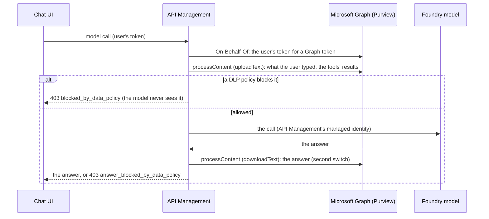

# Purview at the gateway (optional)

An optional part of the demo: API Management checks what goes to the model, and what comes back from it, with
**Microsoft Purview**, as the signed-in user, and refuses it if a data loss prevention (DLP) policy blocks it. It is
off by default; the main demo does not need it.

## How it works



- **Where:** a policy for all APIs that acts only on the model API (`infra/apim-purview`), so that the model API's own
  policy, a shared building block, stays as it is.
- **As the user:** Purview applies DLP policies to content that comes with a user. The gateway's app registration
  exchanges the user's token for a Microsoft Graph token (On-Behalf-Of) with the delegated permissions
  `Content.Process.User`, `ProtectionScopes.Compute.User` and `ContentActivity.Write`, and admin consent.
- **No secret:** the exchange is signed by API Management's managed identity, trusted by the gateway app as a federated
  credential.
- **What is checked:** each call to the model: what the user typed and the tools' results (for example, notes read by
  the notes server). With the second switch, the model's answer too, streamed or not.
- **Fail closed:** if the check cannot be made, the call is refused (503 `data_policy_check_failed`, with the step
  that failed).
- **Headers:** `x-purview-verdict` and `x-purview-answer-verdict` (`allowed`, `blocked` or why the check failed) on
  every checked call.

## Switches

Two API Management named values, `off` by default; a change applies within seconds. Change them in the Azure portal
(the API Management instance > APIs > Named values > edit the value > Save) or with the script:

| Named value | Checks | Note |
|---|---|---|
| `purview-check` | What the model receives | Adds a Purview call to each model call |
| `purview-check-responses` | The model's answers too (with `purview-check` on) | The answer is held until it is checked, so it no longer streams |

```bash
uv run python src/purview_check.py switch on              # prompts and tool results
uv run python src/purview_check.py switch on --answers    # answers too
uv run python src/purview_check.py switch off --answers
uv run python src/purview_check.py switch off
```

## Set up

1. Provision the layer: `azd provision apim-purview --preview`, then `azd provision apim-purview`. It adds the Graph
   permissions, their admin consent (needs an administrator who can grant tenant-wide consent), the federated
   credential, the two switches, a policy fragment and the policy. Both switches start `off`.
2. Create the DLP policy (Compliance Administrator; PowerShell 7 and the ExchangeOnlineManagement module). A DLP
   policy for an application is created with PowerShell:

   ```bash
   pwsh ./src/create-dlp-policy.ps1 -AppId "$(azd env get-value APIM_GATEWAY_CLIENT_ID)" -AlertRecipients <your e-mail>
   ```

   It blocks credit card numbers in both directions (`UploadText`, `DownloadText`), scoped to the gateway app, with a
   High alert. Microsoft Purview pay-as-you-go billing must be set up in the tenant.
3. Check: `uv run python src/purview_check.py switch on`, then `uv run python src/purview_check.py check`.

## Try it

| Test | Expected |
|---|---|
| `purview_check.py check`, prompt "clean" | 200, `prompt=allowed` |
| `purview_check.py check`, prompt "test card" | 403, `prompt=blocked` |
| `purview_check.py check`, prompt "answer" (with `--answers` on) | 403, `prompt=allowed`, `answer=blocked` |
| Chat, new conversation: "Add a note: the customer's credit card number is 4111 1111 1111 1111" | "The gateway refused the request (HTTP 403). blocked_by_data_policy: …"; no note added |
| `purview_check.py seed-note`, then in the chat, new conversation: "List the last 3 notes." | The `notes-list_notes` call, then the same 403: the card is in the tool's result |

The card number is Visa's public test number. Purview's credit card detection combines the number with nearby words
such as "credit card", "card number" or "Visa", which keeps false positives low; the tests use that wording. Start a new
conversation after a refusal: the chat sends the conversation again with the next message.

## Observed (2026-11-04)

- The DLP policy applied about 2 minutes after it was created; adding the answer direction (`DownloadText`) to its
  rule, about 5 minutes after the update.
- Answer check: an answer with the test card number, to a prompt without one, was refused with 403
  `answer_blocked_by_data_policy`; streamed and non-streamed answers were both read and checked.
- Prompt and tool-result checks in the chat: refused with 403 `blocked_by_data_policy`; other messages unchanged.
- The On-Behalf-Of exchange signed by API Management's managed identity worked; no secret is involved.
- Evidence (checked the next morning): one record per refused check, in Advanced Hunting (`CloudAppEvents`,
  `DLPRuleMatch`) and in Purview's Activity explorer ("DLP rule matched", location "AI gateway", enforcement plane
  "Application", with the user, the policy and the rule), and High alerts "DLP policy match for applications" in Purview ([queries.md](queries.md#6-optional-what-purview-refused-at-the-gateway)).

## Turn it off or remove it

- Off: `uv run python src/purview_check.py switch off --answers` and `switch off`.
- Remove: delete the `apim-purview` entry from `azure.yaml` and run `azd provision` after destroying the layer
  (`terraform destroy` in `infra/apim-purview` with the azd environment's values), then remove the DLP policy
  (`Remove-DlpCompliancePolicy`).
